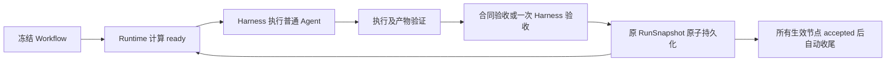

# 确定性 DAG Runtime

本轮以 PR #14 的 `codex-native-flow-acceptance` 为基线。固定流程的调度权交给既有 Runtime，DSH Harness 继续负责智能节点执行。原父代理模式作为 `executionMode: "agent"` 保留。

## 控制流与兼容性

原 Agent 模式：父代理读图 → `wf_run_node` → 子代理结算 → 父代理 `reviews` → 下一次工具调用 → `wf_finish`。

DAG 模式：冻结定义 → Runtime 计算 ready → 既有 `RuntimeExecute` / `NodeAgentRunner` 派发 → `RuntimeObserve` 接收有效代际的结束事件 → 验证合同及任务 → 持久化 → 重新计算 ready → 自动收尾。流程推进不依赖父代理工具调用，也不唤醒父代理讨论下一节点。



`executionMode` 与 `mode1/mode2`、`handoffPolicy: explicit/auto` 分别独立。历史工作流及快照未声明 `executionMode` 时仍是 Agent 模式；不根据 `harnessContext` 推断 DAG。新建 mode1 工作流默认 DAG，mode2 服务保持 Agent。已有模板、资产版本和导入数据没有该字段时不补写默认值。

启动时冻结图、执行模式、并发上限及声明的角色文件内容；恢复读取原 orchestration 文件，不读取后来修改的画布。工作台配置只影响新运行，恢复时不能覆盖冻结模式。同一会话有活动 DAG 时不能混入另一运行，避免共用根会话配置或通知归属。

宿主 SDK 的子代理通知原本会调用根 Agent 的 `followup/steer`。插件仅对已登记为本会话 DAG 子代理的官方结算/消息通知改用公开 `inject`，记录上下文而不启动父回合；用户和其它子代理通知按原方法处理。贡献卸载时恢复方法。没有这些公开能力的宿主明确返回 `WF_DAG_UNSUPPORTED`。没有修改官方源码或全局原型。

## 执行状态与任务验收

`node.status` 保留执行语义；`taskAcceptance` 表示业务验收，不能把 `stopReason=completed` 等同于任务完成。

| 层次 | 结果 | 后续行为 |
| --- | --- | --- |
| 执行/工具/产物校验 | 失败 | 记录真实错误；语义验收不能覆盖 |
| 显式充分合同 | accepted | `execution.completion: "output-files"` 且产物合同全部有效时直接接受 |
| 普通节点的 Harness 验收 | accepted | 持久化成功后才允许下游 |
| Harness 验收 | needs-input | 暂停、等待授权的新输入，不空转 |
| Harness 验收 | failed | 工作流失败，不重复同一业务错误 |
| Harness 验收 | unknown / 非法 JSON / 超时 | 保持 task pending、review blocked，等待干预或新运行 |

`outputFiles` 存在仅证明文件合同满足。只有用户明确声明 `completion: "output-files"` 表达充分完成条件，才能省略语义验收。普通 `inputSchema/outputSchema` 文本是任务说明，不被冒充机器 JSON Schema。本轮没有新增通用 JSON Schema 验证器。

已核查的官方 SDK 提供执行结算信号，没有可直接证明任意业务成功的通用状态字段。本轮没有假设一个不存在的官方业务字段。普通节点最多创建一个隔离的 Harness 验收 child；业务 child 仍可自由输出文本。

验收只接收冻结职责和要求、有效执行代际、实际输出、已验证产物摘要、必要工具结果和直接上游来源。文本有界并标记截断，不复制父会话历史。验收仅返回闭合结构 `{ "status": "accepted|needs-input|failed|unknown", "reason": "..." }`；非法结构绝不默认成功。

验收 child 无工具权限，连普通子代理保留的 `send_message` 也拒绝；预步护栏限制一次逻辑模型请求，输出上限 2048，默认总超时 120 秒（`dagReviewTimeoutMs`）。护栏位于已有恢复钩子之前，并关闭该验收的自动基础设施重试。失败进入 blocked，不再次创建审查父代理。SDK/提供方内部传输行为和实际 Token 仍需现场观测。

验收 origin 保存 worker 的 `runId/nodeId/attempt/childId` 和 `dagDefinitionRunId`；review 单独保存其所属 runId、childId、状态、时限及错误码。恢复已结算但尚未开始验收的 worker 时，worker 的原 runId 和 review 的新 runId 保持区分。相同事件幂等，旧 child/attempt/epoch 不能覆盖新代际。候选 verdict 先经原 FlowStore 原子文件锁落盘，再发布并计算下游；并行分支期间继续保存当前完整事实。

已声明产物在 worker 结算、验收、下游消费及最终收尾时复查；文件签名与原尝试证据必须一致。未声明的文件路径不会因为出现在模型文本中就被登记为 Runtime Artifact；现场销售脚本还会独立读取指定报告和中间文件核对业务内容。

## 调度与条件

`dag-scheduler.ts` 提供纯 ready/frontier 查询。固定图按拓扑层及定义顺序启动，默认并发 2，可明确设置 `dagConcurrency: 1..16`。推进事件由有效结算、绑定和恢复触发，没有模型轮询。沿用现有 dispatching/inflight 互斥，最终收尾前必须无运行和待验收 child。

| 图结构 | DAG 支持 |
| --- | --- |
| 普通 Agent 线性流程 | 支持 |
| 无条件并行、多前驱 AND 汇聚 | 支持；全部生效前驱须业务 accepted |
| 可计算条件、条件汇聚 | 支持；未选路径持久化 skipped，汇聚等待全部生效前驱 |
| File Node、ctx、数据库输入 | 沿用原授权/交接；Agent ctx 来源必须为严格前驱 |
| pause、暂停/恢复、停止/取消 | 沿用原生命周期；暂停不新派发 |
| 自然语言条件、复杂动态路由 | 明确拒绝；可选 Agent 兼容模式 |
| Parent、Proxy、Team/协作组、mode2、循环/动态改图 | 首版 DAG 明确拒绝；原 Agent 模式保留 |

可计算条件必须声明 JSON 字段来源和有限操作，不使用 `eval`。例如 Agent 返回 `{ "route": "branch_b" }` 后，对两个出口分别定义规则：

```json
{
  "id": "to-b",
  "source": "decision",
  "target": "b",
  "sourceHandle": "flow-out",
  "targetHandle": "flow-in",
  "condition": {
    "type": "content",
    "rule": { "path": ["route"], "operator": "eq", "value": "branch_b" }
  }
}
```

操作为 `eq/ne/gt/gte/lt/lte/exists`；不转换类型，不读取原型属性。字段缺失、非法 JSON、类型不符及没有任何有效出口都有稳定错误。路由仅接受当前已验收来源，选择只能指向已有连线，结果存于该 attempt 的 `dagRoutes`；恢复复用结果。语义路由留待下一阶段，以有界 Harness 决策扩展，不能赋予模型修改图或调度权。

## 数据、输入与恢复

复用 #8–#14：`WF_BUSY`、retryLimit、NOT_RESUMABLE 安全重建、run/attempt/child/epoch 隔离、RuntimeInputs 授权与 revision、官方 FileBlock、Flow 文本/来源交接、真实产物签名、RunSnapshot、Guard 与 Sandbox。没有第二套 Runner、输入数据库或事件总线。

普通 `execution: null` 节点可使用官方会话附件和合法直接前驱的实际文本，无须增加 ctx 或强制槽。既有明确绑定和 explicit/auto 合同保持优先级；不按节点名、Prompt 或文件扩展名推断必需输入。附件引用经当前会话再次授权解析，客户端不提供宿主路径。官方附件是否真正被模型读取，需要文件工具事件或现场文件探针验证，不能只依据 `attemptHistory.inputAttachments`。

needs-input 恢复保留 attempts；输入 signature 比较有效绑定、附件引用、文件绑定和合法上游结果，单纯说“已上传”或增加 inputRevision 不构成新输入证据。已运行节点不支持热绑定；仍沿用 `pending && attempts === 0` 的绑定保护，可通过新运行明确携带输入修复。

基础设施重试仅在既有 retryLimit 内、错误可恢复且明确未接收投递，或节点显式声明 `execution.retrySafe: true` 时发生。已确认业务失败不自动重发。无法确认外部副作用或未结算执行是否完成时返回 `WF_DAG_RECOVERY_REQUIRED`，不假设重跑安全。恢复始终生成新的 run，沿用冻结 DAG 身份；accepted 节点不重跑。

暂停期间 worker 正常结算但未开始验收，可在合法恢复后对同一结果验收一次。已经 requested/running/blocked 的未确认验收不能在重启后无限重评，返回 `WF_DAG_REVIEW_INTERRUPTED`，需要明确干预或新运行。停止/取消过滤后续事件，释放原锁与等待器。已持久化的 pending 不被当作 accepted。

## 配置和工作台

新增可选字段：Workflow/Template/Asset/Bundle 的 `executionMode/dagConcurrency`；Snapshot 的冻结模式及 `dagDefinitionRunId`；attempt 的输入 signature、投递证据、工具证据和路由；taskAcceptance 的来源/代际/review；`execution.completion/retrySafe`。

`dagState.ready/blocked` 是冻结图和快照的只读查询投影，不是第二状态源。工作台分别展示执行状态、任务状态、阻塞原因、上游来源和输入附件；ready/accepted/skipped 与正在验收的执行 ok 分开呈现。

既有 SQLite 资产历史增加可空 `execution_json` 元数据列，使模板保存、去重、导入导出和回滚不会丢失模式。迁移幂等，旧版本 NULL 保持历史 Agent 语义；不改写旧版本、不增设 Runtime 存储。旧运行 API、父代理工具、mode1/mode2、explicit/auto 保留。DAG 运行拒绝父代理工具推进/动态实例改图，旧 Agent 模式仍可使用。

主要修改位置：orchestrator 的 DAG 查询/启动/执行/观察/恢复；agent 的公开通知适配、review 工具隔离和请求护栏；shared/config/prompts；API 与现有工作台；storage/assets/transfer 的执行配置往返；集成与兼容测试及同步生成的 `lib`。

## 验证证据

受控测试使用真实 Runtime、NodeAgentRunner、FlowStore、磁盘授权、文件读写和快照；模型/子代理传输及必要宿主服务由受控夹具替代。这属于 Mock/受控集成层，不是真实模型 E2E。

覆盖线性普通节点、并行 AND 汇聚、重复结算、computed 条件/skipped/恢复、Flow 文本及来源、授权 FileBlock、五节点真实磁盘中间文件、缺少输入、业务 needs-input/failed/unknown、非法验收、验收超时、工具失败、产物缺失/变化、暂停恢复/取消、未知副作用、模式冻结和历史兼容。官方 SDK smoke 独立使用已发布 0.1.6-alpha.2 与 0.2.0-rc.2，验证 Preset Scope、工具权限、公开请求/恢复钩子、官方附件投影及通知适配；它没有调用真实模型。

云环境最终结果（2026-10-13）：

| 验证层 | 命令/范围 | 结果 |
| --- | --- | --- |
| 类型、全量受控测试、构建、客户端 smoke | `pnpm check` | 199 个文件 / 2538 个测试通过 |
| 独立构建 | `pnpm build` | 通过，`lib` 已同步 |
| 官方 SDK 服务集成 | `DSH_RUNTIME_PACKAGE=... node scripts/dsh-scope-smoke.mjs`，两版 SDK | 每版 6 次 Preset 查询、20 次工具执行，5 项 review 工具拒绝、单请求护栏、2 项 DAG 通知入队及 2 项其它通知保留通过 |
| 官方文件探针接口 | `node scripts/run-harness-file-live.mjs --sdk-check`，0.1.6-alpha.2 | 通过；未启动模型 |
| 新增/修改代码覆盖 | 全量 V8 测试，基线 #14 `e390c38` | 所配置 orchestrator/agent/assets/API/graph/prompts/storage/tools/transfer/client 范围的 statement-start 可执行修改行 491/540（90.93%）；不计纯类型或文档 |
| 现场脚本 | 语法检查及 `--help` | 通过；没有执行真实模型 |
| Docker/模型 E2E、性能对比 | 用户私有部署 | **NOT RUN** |

真实 Docker/模型五节点 E2E 和 Agent/DAG 性能对比均为 **NOT RUN**：用户的模型部署在私有 Docker 网络，云环境没有可访问配置。没有编造总耗时、父/子/验收 Token、完成率或性能改善。一次语义验收的业务准确性仍需现场验证。

## 现场命令

在已加载本插件的 DSH 宿主、共享同一工作区文件系统的环境执行，使用已配置的准确 provider 标识；不要假设其名称为 ollama/openai，不硬编码模型服务地址或凭据。先完成独立文件探针，若 sandbox backend 不可用，分别诊断容器和沙箱服务，不关闭权限保护。

```bash
export DSH_BASE_URL='<实际 DSH Web 地址>'
export DSH_TEST_PROVIDER='<宿主已配置的准确 provider 名>'
export DSH_TEST_MODEL='qwen3:30b-instruct'
export DSH_TEST_WORKSPACE='<专用且宿主可读写的测试工作区>'
export DSH_RUNTIME_PACKAGE='<官方 @deepseek-ai/dsh/package.json 绝对路径>'
export DSH_TEST_CONFIG='<专用 Cordis 测试配置绝对路径>'

node scripts/run-harness-file-live.mjs
node scripts/run-sales-live.mjs --dag --prepare-only
```

在输出的 DSH 会话中通过官方 UI 上传 `tests/fixtures/sales_workflow_test.csv`，发送消息激活根 Agent，等待其空闲。然后设置输出的会话 ID，复用相同工作区：

```bash
export DSH_TEST_SESSION_ID='<prepare-only 输出的 sessionId>'
node scripts/run-sales-live.mjs --dag
```

多个授权附件时需明确设置 `DSH_TEST_ATTACHMENT_ID`，脚本不会按文件名猜测或选择第一个。DAG 样例所有业务节点 `execution: null`，没有 Parent、ctx 或必需槽；显式 runtime binding 只是选择当前会话的合法附件引用。

`live-flow.json`、`live-run.json`、`live-metrics.json` 与 `output/` 中间文件保存在工作区。脚本断言五个节点各一次有效尝试、task accepted、Runtime completed，实际读取中间产物和最终报告并核对既有销售固定夹具事实。DAG blocked 会停止脚本并保留诊断，不自动补输入/重试。独立文件探针记录官方工具读取证据、每步 Usage 和耗时；销售 runStatus 尚无独立 usage，metrics 显式标记不可用，需现场从 DSH 导出父/子/验收的独立统计及完整工具事件。

可用 `--dag --text`、`--dag --json` 验证普通文本/JSON Flow；去掉 `--dag` 运行旧 Agent 模式（另一个专用会话/工作区）。对比应记录完成率、总耗时、父/子/验收 Token、实际工具次数、重复派发、节点 attempts 和错误分布，不能从测试次数或界面合计推断 Token 降幅。条件语义路由、Team 和动态图将通过显式支持能力扩展，而不是改变旧模式的执行语义。
