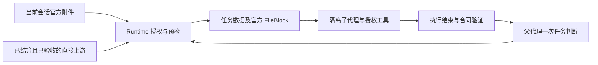

# 默认 Flow 上下文与一次任务验收

基于已合并 #13 的 main（7fe2948）。不回退 #6–#13，不修改 DSH 源码、沙箱、DAG validator、协作组调度或 NodeAgentRunner 的恢复机制。

## 故障依据与修改范围

现场 run-mv517159-h1kd38 的用户提供摘要显示：普通 Agent、execution=null、只有 Flow；未设置 handoffPolicy/runtimeInputs。load_data 有 3 次执行、quality_check 有 2 次，两者 execution status 为 ok；其后节点未执行。后续尝试保存了 inputAttachments，但没有实际读取或 `/root/123/output.json` 真实性的证据。quality_check 请求补充数据仍显示 ok。没有完整工具参数、独立父子 Usage 或耗时统计，本轮不据此归因特定模型格式或断言 DSH 文件服务存在缺陷。

之前的两条问题分别是：未指定策略时普通 Flow 不交接结果；completed 被直接用于节点 ok，缺少独立业务验收。新增默认上下文与一次父代理验收解决这两个协议问题；真实文件读取、模型业务判断、工具适配和 Token 改善须现场验证。

## 新旧运行语义

| 场景 | 行为 |
| --- | --- |
| 新运行，未指定策略 | snapshot 写入 `harnessContext:true`；普通 Agent 获得直接 Agent 前驱上下文，并在正常结束后待任务验收 |
| 明确 explicit / auto | 保留旧严格输入/交接规则，不静默转换 |
| 旧快照无新标记，包括旧快照未存策略 | 恢复保留旧规则；不把历史运行重新解释为新默认 |
| 新默认运行的恢复 | 继承该标记；只有 accepted 的任务结果作为成功继承，未验收/待输入/验收失败的任务不被当作成功断点 |
| 新建运行 | 新 runId、空输入草稿；只继承真实存储的策略选择，旧 API 对缺省策略显示的 explicit 不作为用户选择继承 |

新字段可选，旧快照无迁移要求。高级输入窗口增加“默认（Harness 上游上下文）”，普通运行无需手工选择 auto。仍可主动复用旧输入，显式文件提交继续重新授权。停止后新建运行用于应用新默认；原故障运行的旧断点不会被静默升级。

## 数据流与代码位置



- `runtime-launch.ts` / `resume.ts`：在创建边界冻结默认语义，恢复不改变旧运行版本；客户端 `use-runtime-inputs.ts` 区分新运行与旧策略。
- `input-handoff.ts`：`flowNodeContextOf()` 解析直接 Agent 前驱，按 canonical/proxy ID 去重。每个来源分别包含 nodeId、label、职责摘要、result、runId/attempt/childId、图中连线/条件信息和已验证产物引用；不拼成匿名字符串，不复制父聊天历史。条件描述是图声明，不是机器对条件真假作出的证明。
- `runtime-execute.ts` / `task-blocks.ts` / `node-task.ts`：预检后把来源数据追加到既有任务块，不创建新的 RuntimeInputs。结果/职责摘要沿用文档大小限制；文件正文不展开。新 attempt 的 flowSources 和任务验收要求保存在原 attemptHistory，预检期间上游变化则拒绝派发。
- #13 的 `sessionInputFiles()`、`nodeInputAttachments()`、Runner `startContinuable` / 合法 `sendMessage` 的官方 FileBlock 原样保留。默认 Flow 数据与会话文件并存，不因上游有数据而屏蔽附件。
- `runtime-observe.ts` / `runtime-base.ts`：completed 和机器合同验证决定执行层状态；普通默认节点另记 taskAcceptance=pending。`wf_run_node`、`wf_run_node_wait` 与 `wf_finish` 共用一个 reviews 输入协议，校验代际并持久化一次判断。

明确 ctx、RuntimeInputs、File Node、execution.inputs/requiredFiles 的输入来源优先，继续原合同与授权检查。严格输入节点不被默认上下文覆盖，指定文件来源仍按原明确选择交付。outputFiles 验证输出，不阻断未声明输入来源的普通节点取得 Flow 数据；新默认节点在产物验证后仍可有一次业务验收。inputSchema/outputSchema 仍是柔性说明，不强制普通节点输出固定 JSON。

多个必需上游均须有有效结算。未执行的条件分支不提供数据；失败/待输入/未验收结果不作为成功业务数据。多个已执行条件来源不明时，父代理在原调度调用中用 flowSources 选择直接来源；不能省略无条件必需前驱。选定来源及版本记录在 attemptHistory；没有新 DAG scheduler。

声明文件仍使用 `verifyNodeArtifacts()`、授权工作目录及写入签名验证当前 run/attempt 的产物，交接前再验证。未声明产物的回复路径保持文本，不登记为已验证文件；不扫描目录，也不从任意文本推断文件授权。普通文本/JSON任务不需要 outputFiles。需要机器证明文件交付时，可选声明原 outputFiles 合同。

## 有界验收协议

执行层 `status=ok` 代表正常结束及已有合同校验，不自动证明普通任务已完成。画布分别显示“执行结束，待验收”“待补充输入”“任务验收失败”，不覆盖原执行事实。

父代理根据节点任务、结果与工具证据做一次判断，可随下一次节点调度或收尾提交：

```json
{
  "nodeId": "next",
  "reviews": [{
    "nodeId": "producer", "runId": "节点工具返回的工作流运行ID",
    "attempt": 1, "childId": "节点工具返回的子代理ID",
    "status": "accepted", "reason": "结果满足节点任务的简短依据"
  }]
}
```

status 还可以是 needs-input 或 failed。这是父代理的业务判断，不是机器证明；不增加一个审查 Agent，也不要求子代理使用固定输出 JSON。启动/等待回执提供 runId/attempt/childId，等待结果另返回 taskAcceptance。一次判断在同 attempt 内不能反复改写；相同判断的重放幂等，旧代际返回 `WF_TASK_REVIEW_CONFLICT`。

pending 的同一结果不得重新派发或供下游消费，返回 `WF_TASK_REVIEW_REQUIRED`。needs-input 且没有新授权附件时，同节点重试返回 `WF_TASK_INPUT_REQUIRED`，不增加尝试次数；自然语言“已上传”不是新证据。新授权文件只能在原预算内的新 attempt 交付，不能进入旧 attempt。无法安全修复时使用原停止/恢复/新运行或失败收尾，不热绑定、不清零原运行次数。

ctx 也不能消费待验收结果。已派发任务的验收要求冻结在 attemptHistory，后续画布调整不会取消该要求。条件失败处理路径可显式恢复，但不会把失败回复当成业务数据；最终收尾仍检查未结算/未验收及原必需路径。wf_finish 幂等、WF_BUSY、retryLimit、NOT_RESUMABLE、epoch/旧事件隔离均保留。

父代理提示用简短的一次验收原则替换原笼统成功说明；没有按“上传”“CSV”“某个字段”识别业务完成的生产关键词规则。模型仍可能作出错误判断；单元测试不能证明业务质量或 Token 改善。

## 四阶段文件证据与工具观测

1. **授权引用**：既有官方 Session user/message 与附件服务校验；引用元数据不等于读取证据。
2. **受控派发**：attemptHistory.inputAttachments 是准备交付的引用，childId/phase 标识派发接纳；不能据此声称文件已被消费。
3. **官方文件上下文**：官方 `dsh-llm` 将 FileBlock 投影成文件句柄，经官方 fs 映射执行环境路径。现有 SDK smoke 验证投影和不可变 durable 引用；公开 llm/stream 钩子在最终投影前，不能声称观察到了最终 provider wire payload。
4. **实际读取**：新增独立真实 Harness 探针捕获官方 read 调用与工具返回的随机文件内容，并核查模型报告。它不依赖五节点 Workflow，也不向 Prompt 提供该随机内容。

`visual-workflow-host.ts` 订阅官方 tools/result；Runtime 仅记录当前 Workflow 的 parent/child、runId/attempt、tool/callId/rootCallId、isError 和稳定错误码，不记录参数/文件正文，不增加 Token 数据库。可用日志按 callId 区分根调用与内层 dispatch，不能把两者混作模型调用。创建登记前的极早工具事件或 SDK 未暴露的失败可能不在插件日志里，日志缺失不是未读取的证明。

wf_run_node 与真实注册 Schema 的 flat nodeId/reviews 参数已在官方 SDK smoke 检查；嵌套 arguments 明确失败，不对 Qwen 或其他模型进行格式猜测修正。现场若 send_message unavailable、参数解析或 sandbox 失败，应保留真实 tool/call 与 tool/result、Scope/Preset 配置和错误码再定位；目前没有这些完整现场日志。

## 独立真实文件读取探针

`scripts/run-harness-file-live.mjs` 使用公开的 `dsh-app-boot.boot()`、AgentRegistry.create/setup、agentPresets.mount、attachments.saveFile、subagents.startContinuable/spawn、session/event、llm/stream 与 tools/result。可设置准确 provider/model，使用独立测试 Cordis 配置中已有的模型、工具、权限与 sandbox；不自动改 profile、地址、凭据或切换 danger-full-access。

配置须包含真实附件、Agent/Preset、子代理 spawn、LLM 和 FS 服务；空的 profile 根文件不等于已展开服务树，勿复用占用现场服务端口的启动配置。使用现场已有配置/展开服务树准备专用测试配置。脚本只创建自己的附件和 Agent，完成后清理 Agent/运行树；官方附件存储仍保留该探针文件供审计。

```bash
DSH_RUNTIME_PACKAGE="$YOUR_DSH_PACKAGE_JSON" \
DSH_TEST_CONFIG="$YOUR_TEST_CORDIS_CONFIG" \
DSH_TEST_PROVIDER="$YOUR_DSH_PROVIDER" \
DSH_TEST_MODEL="$YOUR_DSH_MODEL" \
DSH_TEST_WORKSPACE="$YOUR_DSH_WORKSPACE" \
node scripts/run-harness-file-live.mjs
```

`--help` 无模型/配置启动；`--sdk-check` 只验证已发布方法。报告默认写入 harness-file-live-result.json，包含四阶段证据、实际工具成败、句柄/读取路径关联、父子模型事件数量、SDK Usage 可用项及耗时。只累计当前新 Session 的官方 assistant/message Usage；输入、输出与缓存计数分开，缺失项标 unavailable，部分报告注明 complete=false，不以界面汇总值猜测去重总量。

先独立确认子代理能读，再新建一个普通工作流：文本计划、两个不同文件的读取节点、多来源汇聚、条件分支、最终报告。在实例所属会话上传小文件，普通节点不设置 execution.inputs、ctx 或手动 auto；最终报告如果需要机器证明，保留可选 outputFiles。检查实际 read、flowSources、任务验收与 wf_finish；再验证显式合同和暂停/恢复。独立探针失败不能据此归因为 Flow 交接。

## 验证与未完成的现场工作

回归覆盖真实 Runtime、NodeAgentRunner、输入解析/授权、磁盘持久化与文件产物，使用可控 SDK 传输及宿主事实。另用未修改的两个官方 SDK 进行 Scope、工具 Schema 和文件存储/投影 smoke。上述层次均不是完整真实模型 E2E。

默认无 ctx/未指定策略和旧 explicit 的综合六节点流程均通过：文本、双文件读取、三来源汇聚、条件检查和真实报告；每条路径派发/执行成功 6 个 Agent、各 attempts=1，新默认另有 6 次接受决策。确定性普通文本链实际派发/接受 3 个 Agent，各 attempts=1；单/双附件流程各派发 2 个 Agent，各 attempts=1；多来源/条件汇聚保留来源和选择，未选分支 skipped/attempts=0。输入请求的第一轮 completed 被记为待验收/待输入，拒绝的调用不增预算；新授权文件通过合法第二次 attempt 和 NOT_RESUMABLE 重建继续。真实目录中的声明产物可交接，事后替换拒绝，回复路径无机器产物证据。

`pnpm check` 通过：197 个文件 / 2462 项测试（较 #13 增加 28 项），包含四个 TS Program、构建和 client-smoke；独立 `pnpm build` 通过，同步 30 个 lib 文件。156 项定向测试通过，指定业务文件的可计量新增/修改行覆盖 113/115（98.26%），不是仓库整体覆盖率。两版官方 SDK 各通过 6 次 Preset 读取、15 次作用域工具执行、2 次 Workflow Schema 调用及文件存储/投影；新探针公开接口检查两版通过。全量测试阶段 37.93 秒、定向套件 3.21 秒均不是模型耗时，Fake/SDK smoke 不提供真实 Token 改善结论。

**真实 DSH 模型 E2E：NOT RUN**。云环境不能访问用户内部 Docker 部署，准确 provider 和模型配置不可用。新探针及通用多节点现场模型验收均未运行；真实模型 Token、耗时、启动/成功/attempts 指标 unavailable。用户提供的故障摘要保留为故障证据，不混入回归测试统计。

剩余边界：默认数据交接针对单角色 Agent 的直接 Agent 前驱；父代理 hybrid 自执行、结构门后的间接来源及整组 Team 的数据通道沿用原 ctx/团队机制。显式多候选输入仍可在高级工作台/API 配置；已执行节点仍不热绑定。未声明的文件不会从路径文字自动登记为验证产物。实际 sandbox/工作目录映射、模型正确使用工具和父代理判断质量需现场验证；没有权限放宽或环境绕过。
